<div align="center">

<picture>
  <source media="(prefers-color-scheme: dark)" srcset="docs/logo-dark.svg">
  
</picture>

<br/>
<br/>

[](https://github.com/PedroLiu1999/lubelogger-mcp/actions/workflows/ci.yml)
[](https://nodejs.org/)
[](https://modelcontextprotocol.io/)
[](https://lubelogger.com/)

A self-contained Model Context Protocol (MCP) server that connects a self-hosted [LubeLogger](https://lubelogger.com/) vehicle maintenance instance to AI assistants, including Claude Desktop, Cursor, Google Gemini, and custom agents.

</div>

---

## Overview

`lubelogger-mcp` exposes your personal or family automotive records to AI models over Streamable HTTP (`POST /mcp`) with an embedded OAuth 2.1 server that supports PKCE (`S256`) and RFC 7591 dynamic client registration.

Designed for self-hosted VPS deployments alongside LubeLogger, `lubelogger-mcp` features in-process vehicle name resolution, consolidated Resource Facades with standardized result envelopes, in-memory vehicle caching, and safety annotations on all operations.

---

## Architecture

<p align="center">
  
</p>

---

## MCP Tools Reference

`lubelogger-mcp` provides 15 MCP tools organized into 3 clear categories:
1. **7 Read Tools** (`readOnlyHint: true`, `destructiveHint: false`)
2. **5 Deep Resource Facades** (`readOnlyHint: false`, `destructiveHint: true`)
3. **3 Operational Write Tools** (`readOnlyHint: false`, `destructiveHint: false`)

### 1. Read Tools (`readOnlyHint: true`, `destructiveHint: false`)

| Tool | Description | Parameters |
| :--- | :--- | :--- |
| `get_server_info` | Inspect LubeLogger server version, instance details, and health status. | `checkForUpdate?` (`boolean`) |
| `list_vehicles` | List all vehicles in the garage with ID, year, make, model, license plate, fuel type, and tags. | `forceSync?` (`boolean`) |
| `get_vehicle_info` | Detailed metrics and costs for a vehicle (resolved by ID, plate, or name) including total service cost, repair cost, upgrade cost, gas cost, tax cost, and pending reminder counts. | `vehicle` (`string \| number`, required), `forceSync?` (`boolean`) |
| `get_records` | Query records across all vehicles or for a single vehicle by type (`'service' \| 'repair' \| 'upgrade' \| 'gas' \| 'odometer' \| 'tax' \| 'note' \| 'reminder' \| 'plan' \| 'supply' \| 'equipment'`). | `recordType` (enum, required), `vehicle?` (`string \| number`), `startDate?` (`YYYY-MM-DD`), `endDate?` (`YYYY-MM-DD`), `tags?` (`string`), `limit?` (`1..500`) |
| `get_maintenance_summary` | Aggregate maintenance, repair, fuel, and operating spend across categories for a vehicle or for the entire garage. | `vehicle?` (`string \| number`) |
| `list_reminders` | Query active or upcoming maintenance reminders across all vehicles or for a specific vehicle with urgency and due status. | `vehicle?` (`string \| number`), `urgency?` (`'NotUrgent' \| 'Urgent' \| 'VeryUrgent'`), `forceSync?` (`boolean`) |
| `get_extra_fields` | List user-defined custom extra fields configured for vehicles and records. | _none_ |

### 2. Deep Resource Facades (`readOnlyHint: false`, `destructiveHint: true`)

| Tool | Destructive | Description | Parameters |
| :--- | :---: | :--- | :--- |
| `manage_vehicles` | `true` | Consolidated Resource Facade for vehicle lifecycle (`action: 'create' \| 'update' \| 'delete'`). Supports in-process name and plate resolution on update/delete. | `action` (`'create' \| 'update' \| 'delete'`, required), `vehicle?` (`string \| number`), `year?` (`number`), `make?` (`string`), `model?` (`string`), `licensePlate?` (`string`), `fuelType?` (`string`), `isElectric?` (`boolean`), `tags?` (`string \| string[]`) |
| `manage_records` | `true` | Consolidated Resource Facade for maintenance records (`recordType: 'service' \| 'repair' \| 'upgrade' \| 'gas' \| 'tax' \| 'note' \| 'odometer'`, `action: 'create' \| 'update' \| 'delete'`). Automatically resolves vehicle names in-process. | `recordType` (enum, required), `action` (enum, required), `vehicle?` (`string \| number`), `id?` (`string \| number`), `date?` (`YYYY-MM-DD`), `odometer?` (`number`), `description?` (`string`), `cost?` (`number`), `notes?` (`string`), `tags?` (`string \| string[]`), `fuelConsumed?` (`number`), `isFillToFull?` (`boolean`), `missedFuelUp?` (`boolean`), `startingSoc?` (`number`), `endingSoc?` (`number`), `noteText?` (`string`), `pinned?` (`boolean`) |
| `manage_reminders` | `true` | Consolidated Resource Facade for scheduled reminders (`action: 'create' \| 'update' \| 'delete'`). | `action` (`'create' \| 'update' \| 'delete'`, required), `vehicle?` (`string \| number`), `id?` (`string \| number`), `description?` (`string`), `urgency?` (`'NotUrgent' \| 'Urgent' \| 'VeryUrgent'`), `metric?` (`'Date' \| 'Odometer' \| 'Both'`), `dueDate?` (`YYYY-MM-DD`), `dueOdometer?` (`number`), `notes?` (`string`), `tags?` (`string \| string[]`) |
| `manage_plans` | `true` | Consolidated Resource Facade for planned tasks and future upgrades (`action: 'create' \| 'update' \| 'delete'`). | `action` (`'create' \| 'update' \| 'delete'`, required), `vehicle?` (`string \| number`), `id?` (`string \| number`), `description?` (`string`), `priority?` (`'Critical' \| 'Normal' \| 'Low'`), `progress?` (`'Backlog' \| 'InProgress' \| 'Testing' \| 'Done'`), `cost?` (`number`), `notes?` (`string`) |
| `manage_supplies` | `true` | Consolidated Resource Facade for garage spare parts and supplies inventory (`action: 'create' \| 'update' \| 'delete'`). | `action` (`'create' \| 'update' \| 'delete'`, required), `vehicle?` (`string \| number`), `id?` (`string \| number`), `partNumber?` (`string`), `partSupplier?` (`string`), `partQuantity?` (`number`), `description?` (`string`), `cost?` (`number`), `notes?` (`string`) |

### 3. Operational Write Tools (`readOnlyHint: false`, `destructiveHint: false`)

| Tool | Destructive | Description | Parameters |
| :--- | :---: | :--- | :--- |
| `trigger_reminders` | `false` | Trigger automated reminder checks and notification emails on the LubeLogger server. | `urgency?` (`'NotUrgent' \| 'Urgent' \| 'VeryUrgent'`) |
| `recalculate_odometer` | `false` | Recalculate distance and odometer timeline across all records for a vehicle. | `vehicle` (`string \| number`, required) |
| `create_backup` | `false` | Trigger a database backup on the LubeLogger server. | `outputName?` (`string`) |

---

## Quick Start

### 1. Interactive Setup Wizard

To install on your server, run the setup wizard:

```bash
mkdir -p lubelogger-mcp && cd lubelogger-mcp
bash -c "$(curl -fsSL https://raw.githubusercontent.com/PedroLiu1999/lubelogger-mcp/main/scripts/setup-wizard.sh)"
```

The wizard will:
1. Configure `.env` with your `PUBLIC_URL` and `PORT`.
2. Configure your LubeLogger server URL (`LUBELOGGER_URL`).
3. Launch the server via Docker Compose.

---

### 2. Manual Docker Compose Setup

1. Copy `.env.example` to `.env` and fill in your values:

```bash
cp .env.example .env
```

2. Start the service:

```bash
docker compose up -d
```

3. Check container health:

```bash
curl http://127.0.0.1:3000/healthz
```

---

## Configuration (`.env`)

| Variable | Description | Default |
| :--- | :--- | :--- |
| `PUBLIC_URL` | Public HTTPS base URL (e.g. `https://lubelogger-mcp.example.com`). | *Required* |
| `PORT` | Local host port bound to container. | `3000` |
| `DATA_DIR` | Directory inside container for persistent OAuth token storage. | `/data` |
| `OAUTH_ALLOWED_REDIRECT_URIS` | Comma-separated list of allowed OAuth redirect URI prefixes. | *Localhost & Gemini* |
| `LUBELOGGER_URL` | Base URL of self-hosted LubeLogger instance. | `http://host.docker.internal:8383` |
| `LUBELOGGER_API_KEY` | Optional server-wide default API Key. (Omit to use pure dynamic per-user auth). | *Optional* |
| `LUBELOGGER_USERNAME` | Username for optional server-wide Basic Auth fallback. | *Optional* |
| `LUBELOGGER_PASSWORD` | Password for optional server-wide Basic Auth fallback. | *Optional* |
| `CACHE_TTL_SECONDS` | In-memory vehicle cache TTL in seconds. | `30` |

---

## Connecting AI Clients

### Authentication & Security (Zero-Password Architecture)

`lubelogger-mcp` implements an **API-Key-First Branded Consent Screen** (the "Home Assistant Pattern"):

* **Zero Plaintext or Decodable Passwords:** Your primary LubeLogger account password is never collected, transmitted, or stored.
* **Revocable Capability Tokens:** Authentication relies on disposable LubeLogger API keys (`x-api-key`). If ever rotated or deleted in LubeLogger under **Settings ➔ Profile ➔ API Keys**, access is instantly revoked without risking your master account login.
* **Branded Dark Theme:** The `/authorize` page features native LubeLogger dark styling (`#0F172A` / `#1E293B`), the official **LubeLogger MCP logo** (`docs/logo-dark.svg`), and direct deeplinks to your LubeLogger instance settings.
* **OAuth 2.1 Compliant:** Fully implements RFC 7636 PKCE (`S256`), RFC 7591 dynamic client registration, and RFC 6750 Bearer token lifecycles.

For deeper architectural analysis, see [docs/spec-api-key-first-auth.md](docs/spec-api-key-first-auth.md) and [docs/research-ha-mcp-auth.md](docs/research-ha-mcp-auth.md).

### Claude Desktop

Add to your `claude_desktop_config.json`:

```json
{
  "mcpServers": {
    "lubelogger": {
      "url": "https://lubelogger-mcp.example.com/mcp"
    }
  }
}
```

When connecting for the first time, your browser will open to `/authorize`. Authorize access by pasting your **LubeLogger API Key** (generated under *Settings ➔ Profile ➔ API Keys* with Editor or Manager permissions).

### Cursor & Google Gemini

1. Add a **Custom MCP Server**.
2. Select **Server URL** / **Streamable HTTP**.
3. Set the endpoint: `https://lubelogger-mcp.example.com/mcp`.
4. Enter your LubeLogger API key when prompted on the branded authorization screen.

---

## Development & Testing

```bash
# Install dependencies
npm install

# Run test suite
npm test

# Build TypeScript
npm run build
```

---

## License

MIT
